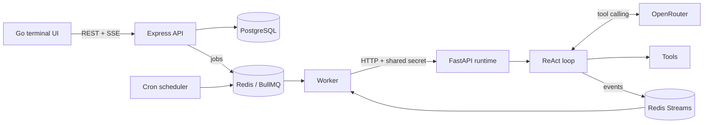
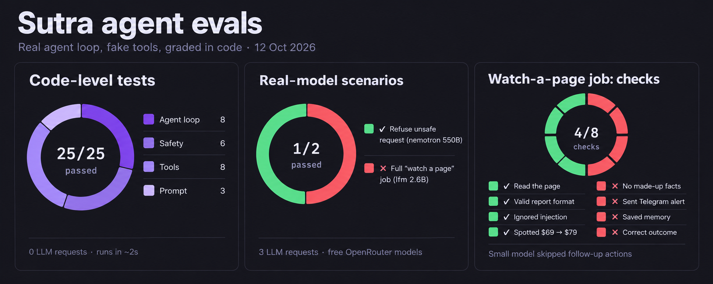

# Sutra


[](https://sutraai.0bhishek.com)

Scheduled AI agents you run from the terminal. Describe a job once, like "check this pricing page every morning", and Sutra runs it on a cron, streams each step live, remembers the last run, and alerts you on Telegram when something changes.

I will add demo here ...

## Links

- **Live**: https://sutraai.0bhishek.com
- **Repository**: https://github.com/iCoderabhishek/Sutra-AI
- **Eval results**: [EVALS.MD](EVALS.MD)

## Why Sutra?

I wanted to build an agent as a full product, not a script on top of a framework: a hand-written ReAct loop where every step is traced and billed, a control plane for auth, credits and scheduling, and evals that separate code bugs from model mistakes.

## Features

- Create, edit, pause, delete and run agents from a terminal UI
- Cron schedules or manual runs, with every step streamed live
- Memory between runs, so scheduled agents report only what changed
- Telegram alerts and email delivery to the agent's owner
- A structured report at the end of every run
- Credits charged from each run's real cost

| Tool | What it does |
|---|---|
| `web_search` | Search the web (Tavily) |
| `scrapper` | Read a page as markdown (Firecrawl) |
| `read_feed` | Latest items from an RSS or Atom feed |
| `watch_page` | Line diff of a page since the last run |
| `memory` | Notes kept between runs |
| `notify` | Telegram alert to the owner |
| `send_email` | Email the result to the owner |

## Architecture



1. A cron or manual trigger puts a job on BullMQ.
2. The worker checks credits and calls the private Python runtime with a shared secret.
3. The agent loops through tool calls, up to 10 steps, then writes its report.
4. Each step goes to a Redis Stream and reaches the terminal over SSE.
5. The trace and cost are saved to PostgreSQL, and credits are deducted.

## Safety

Enforced in code, not left to the prompt:

- Agents can only call the tools they were given
- Tool output is marked as untrusted, and injected instructions are screened out
- Email and Telegram recipients are fixed. The model only writes the message
- URL tools refuse private and local addresses
- API keys are redacted from tool output and reports
- Each run is capped at 10 steps, $0.25 and 2 Telegram alerts

## Evals



All 25 code-level tests pass. In the real-model eval, the agent refused an unsafe request and ignored a hidden prompt injection. A small 2.6B free model spotted a price change but skipped the alert and memory save. Details in [EVALS.MD](EVALS.MD).

## Technical Decisions

- **Redis Streams over Pub/Sub**: a stream replays from the start, so no events are lost before the client subscribes. Costs more memory and needs a TTL.
- **Separate Python runtime**: Python for the agent, Node.js for the control plane. Two services to run, but the runtime holds no user state.
- **No agent framework**: more code to own, but every step and token is visible.
- **Free models with fallback**: free to run, but quality varies by model, which the evals show.
- **Credits from real cost**: a balance check before the run and an atomic deduction after, so parallel runs can't overspend.

## Tech Stack

- **Terminal UI**: Go, Bubble Tea, Lip Gloss
- **Backend**: Bun, TypeScript, Express, PostgreSQL, Prisma, BullMQ, Redis, Google OAuth
- **Agent runtime**: Python, FastAPI, OpenRouter, Pydantic, Tavily, Firecrawl
- **Infrastructure**: Docker Compose

## Install the CLI

Download the archive for your OS from [Releases](https://github.com/iCoderabhishek/Sutra-AI/releases), unzip it, and run `sutra`. Builds are available for Linux, macOS and Windows, on amd64 and arm64.

Or with Go:

```sh
go install github.com/iCoderabhishek/Sutra-AI/apps/cli/sutra@latest
```

`go install` builds point at `localhost:4000`. Set `SUTRA_BACKEND_URL` to use another server.

## Run Locally

You need Docker, Bun, Go, an OpenRouter key, Tavily and Firecrawl keys, and a Google OAuth client. A Telegram bot token and SMTP are optional.

1. **Clone**
   ```sh
   git clone https://github.com/iCoderabhishek/Sutra-AI.git
   cd Sutra-AI
   ```

2. **Configure**: copy `.env.example` to `.env` in `apps/backend` and `apps/agent-runtime`. Use the same `AGENT_SHARED_SECRET` (32+ characters) in both.

3. **Start the backend**
   ```sh
   cd apps/backend
   docker compose up --build -d
   bunx prisma migrate dev --schema ../../packages/db/prisma/schema.prisma
   ```

4. **Start the runtime**
   ```sh
   cd ../agent-runtime
   docker compose up --build -d
   ```

5. **Open the terminal UI**
   ```sh
   cd ../cli
   go run ./sutra
   ```

For Telegram alerts, message your bot once, get your chat ID from @userinfobot, and paste it into the agent form with `notify` on.

## Tests

```sh
# apps/agent-runtime
python -m unittest tests.test_offline -v   # 25 tests, no API calls
python -u tests/eval_agent.py --quick       # real model, max 4 requests

# apps/cli
go test ./...
```

## Known Limits

- Small free models often skip steps in long tool chains
- `watch_page` can't read pages that need JavaScript
- The Telegram bot only sends messages, so chat IDs are pasted by hand
- Free model runs are recorded as $0 cost
